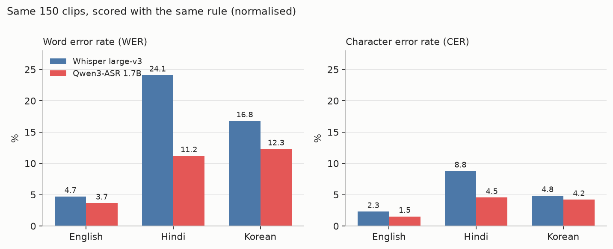
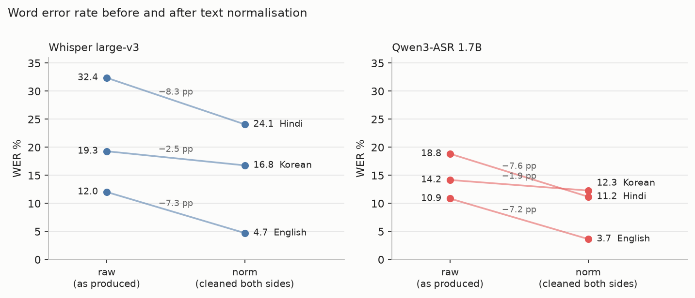
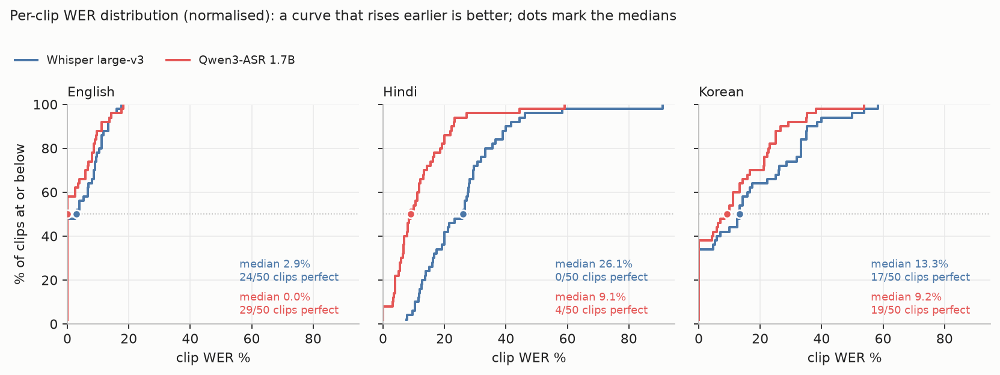
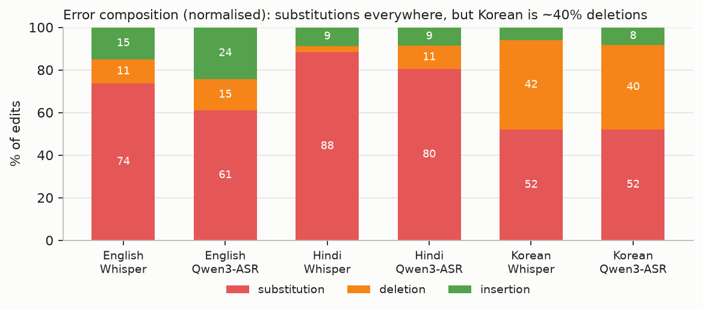
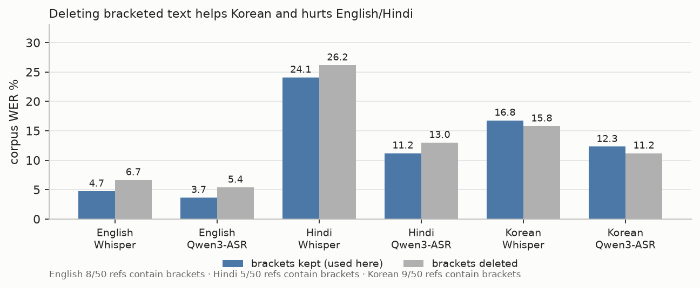
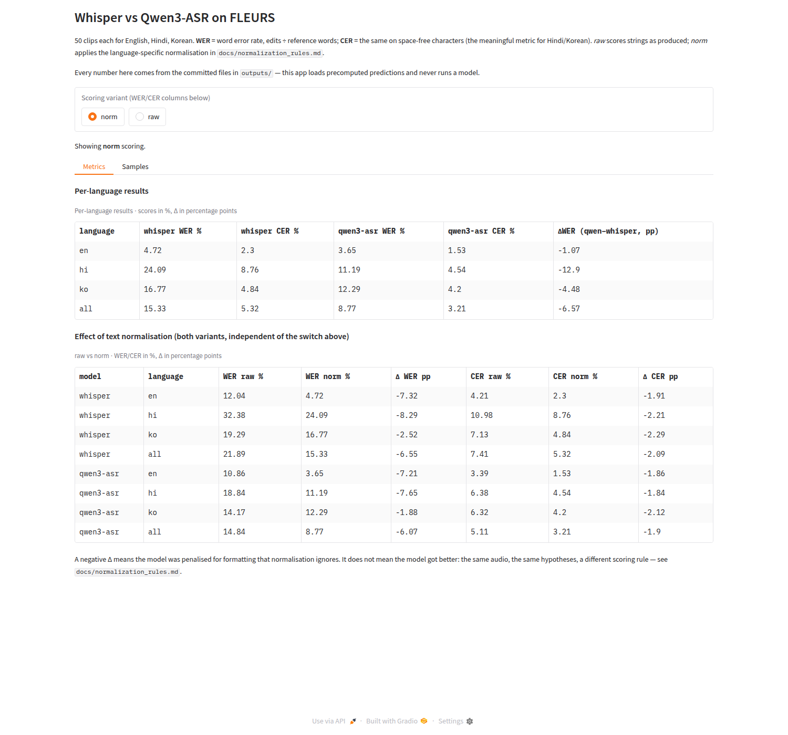
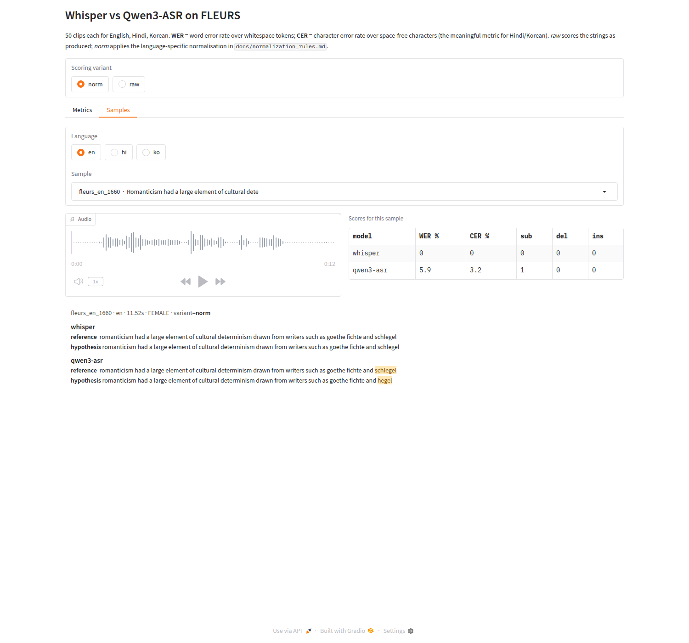

# asr-bench — Whisper vs Qwen3-ASR on a frozen FLEURS subset

A small, reproducible multilingual automatic speech recognition (**ASR**) benchmark and
error-analysis tool: 150 fixed clips of FLEURS (English / Hindi / Korean, 50 each), two models run
through their official interfaces, one scoring rule, a raw-vs-normalised comparison, and a Gradio
viewer for the results.

**Headline result** — corpus WER, normalised scoring, 50 clips per language:

| | English | Hindi | Korean | all 150 |
|---|---:|---:|---:|---:|
| Whisper `large-v3` | 4.72% | 24.09% | 16.77% | 15.33% |
| Qwen3-ASR 1.7B | **3.65%** | **11.19%** | **12.29%** | **8.77%** |



*Figure 1 — same 150 clips, one scoring rule. English is a near-tie (4.7 vs 3.7 WER); Hindi is the
wide gap (24.1 vs 11.2); Korean sits between (16.8 vs 12.3).*

Qwen3-ASR wins every language, by ~1 pp on English and by 13 pp on Hindi. Roughly half of
Whisper's score is formatting rather than recognition (raw → normalised: 21.89% → 15.33%), and the
gap survives that correction (−7.05 pp raw, −6.57 pp normalised). Details, caveats and the
error-by-error analysis follow; none of this is a ranking claim without an uncertainty analysis,
which was not run.

**Two scoring variants, same predictions, same references:**

- **`raw`** — the strings exactly as FLEURS published them and as the model emitted them. Only
  whitespace tokenises; nothing is rewritten. This measures "did the model produce this literal
  text", so a correct answer with different punctuation or digit style counts as an error.
- **`norm`** — the same text after the per-language clean-up in
  [What `norm` actually does](#what-norm-actually-does), applied **identically to reference and
  hypothesis**, before WER/CER are computed. This measures "did the model say the right words".

Both are reported everywhere; neither replaces the other, and `norm` does not make a model better
— the audio and the hypotheses are untouched, only the ruler changes.

## Scope (frozen)

| | |
|---|---|
| Languages | English (`en_us`), Hindi (`hi_in`), Korean (`ko_kr`) |
| Clips | 150 total — 50 per language, fixed list in `data/manifest.jsonl` |
| Data | FLEURS — Google's read-aloud Wikipedia/books corpus — `test` split, revision `70bb2e84…` (pinned), CC-BY-4.0 |
| Models | `openai/whisper-large-v3` (openai-whisper) and `Qwen/Qwen3-ASR-1.7B-hf` (Transformers) |
| Metrics | **WER** = word error rate, edits ÷ reference words (whitespace tokens), **CER** = the same on space-free characters. Corpus-level = summed over the 50 clips, not averaged per clip. Differences are in **pp** = percentage points |
| Scoring variants | `raw` (as produced) and `norm` (per-language normalisation) |
| Language mode | forced per clip for both models, so the comparison is like-for-like |

**Not in scope** (deliberately): no model training or fine-tuning, no audio resampling or
denoising experiments, no streaming, no translation, no extra languages, no test-set sampling
to "balance" anything, no LLM-based semantic scoring, no hyper-parameter search.

## Results

WER / CER in %, corpus-level over the 50 clips of each language (150 total). Full tables with S/D/I counts and per-clip
scores are in `outputs/`; error mechanisms are analysed case by case in
[`docs/error_analysis.md`](docs/error_analysis.md).

After normalisation (`norm` variant):

| language | Whisper WER % | Qwen3-ASR WER % | ΔWER pp | Whisper CER % | Qwen3-ASR CER % | ΔCER pp |
|---|---:|---:|---:|---:|---:|---:|
| en (50) | 4.72 | **3.65** | −1.07 | 2.30 | **1.53** | −0.77 |
| hi (50) | 24.09 | **11.19** | −12.90 | 8.76 | **4.54** | −4.22 |
| ko (50) | 16.77 | **12.29** | −4.48 | 4.84 | **4.20** | −0.64 |
| en+hi+ko (150) | 15.33 | **8.77** | −6.57 | 5.32 | **3.21** | −2.11 |

**Effect of normalisation (same audio, same hypotheses, different scoring rule):**

| language | Whisper WER raw → norm | Qwen3-ASR WER raw → norm | Whisper CER raw → norm | Qwen3-ASR CER raw → norm |
|---|---|---|---|---|
| en | 12.04% → 4.72% | 10.86% → 3.65% | 4.21% → 2.30% | 3.39% → 1.53% |
| hi | 32.38% → 24.09% | 18.84% → 11.19% | 10.98% → 8.76% | 6.38% → 4.54% |
| ko | 19.29% → 16.77% | 14.17% → 12.29% | 7.13% → 4.84% | 6.32% → 4.20% |
| all | 21.89% → 15.33% | 14.84% → 8.77% | 7.41% → 5.32% | 5.11% → 3.21% |



*Figure 2 — each line is one model on one language: left end as produced, right end after text
clean-up. The length of a line is how much of that model's apparent error rate was formatting, not
recognition. Whisper's English loses 7.3 pp this way, Qwen3-ASR's Hindi 7.6 pp; Korean changes
least (2.5 and 1.9 pp).*

**What survives normalisation:** the Qwen3-ASR − Whisper WER gap is −7.05 pp raw and −6.57 pp
normalised (from unrounded rates — the rounded table subtracts to 6.56, which is also correct
arithmetic on the rounded numbers). Both models lose 1.9–8.3 WER points to formatting, so the gap
is mostly recognition quality rather than formatting, and the ranking does not depend on the
scoring variant.

**Not just the average.** Half the clips are near-perfect and a few are catastrophic, so the mean
hides the shape. Share of clips below each error rate (higher curve = better model):



*Figure 3 — share of clips at or below each error rate; dots mark medians.*

The same picture in numbers: 37 of 150 clips are perfect for both models; 52 are perfect for
Qwen3-ASR, 41 for Whisper. Medians (Whisper → Qwen3-ASR): English 2.9% → 0.0%, Hindi 26.1% → 9.1%,
Korean 13.3% → 9.2%. Hindi separates across the whole distribution (Whisper has **no** perfect clip
there), English only in the tail, and Qwen3-ASR is *worse* than Whisper on 10 clips — every ranking
has exceptions, which is why the per-clip files are committed alongside the averages.

**What kind of errors these are** (share of edits, normalised scoring):



*Figure 4 — how each model's edits split into substitutions, deletions and insertions
(percentages inside the bars).*

Numbers inside the bars are percentages of that model's edits. Substitutions are everywhere; Korean
is the outlier with ~40% deletions, which is the eojeol spacing effect below.

**Three findings worth reading the details for:**
1. **Bracketed text is not free either way.** FLEURS references contain asides in parentheses,
   some read aloud (`…can climb (though not well), swim…`) and some only written
   (`80 km (50 mi)`). The stock English normaliser deletes them; measuring both policies on this
   subset shows deleting costs both models 1.7–2.1 pp WER on English and Hindi but *saves*
   1.8–2.0 pp on Korean (Figure 5). This repo keeps the text, so a model is charged for what it
   says, and reports the ~2 pp Korean cost.
2. **On Hindi and Korean, WER measures spelling policy as much as listening.** Where a word breaks
   (Hindi compounds) and where a space goes (Korean *eojeol* — the spacing-defined word block),
   plus the *nukta* dot that changes a Devanagari consonant, move WER by whole words. CER is
   reported for that reason; both metrics agree on the ranking here.
3. **A rule set can be one-sided.** English folds spoken numbers to digits; Korean does not, so
   Whisper saying `백오십` where the reference has `150` is charged (case 16 in
   `docs/error_analysis.md`).



*Figure 5 — finding 1 in one picture: the same predictions scored with bracketed text kept (blue,
what the tables use) or deleted. Bars are corpus WER %; the counts under the axis are how many
references per language contain brackets.*

No uncertainty analysis was run (no bootstrap, no repeated decoding), so treat this as 150 point
estimates, not as a ranking with error bars: the English gap of about 1 pp is well inside what
sampling variation could produce at this size, while the Hindi gap is far larger than any
plausible sampling effect.


## Demo

`uv run python app/gradio_app.py` → http://127.0.0.1:7860 (no model loading; reads `outputs/` only).

**Metrics tab** — per-language scores for the selected variant, plus the raw-vs-norm comparison
([full size](docs/img/app_metrics.png)):



**Samples tab** — audio, both models' per-clip scores, and a word-level diff
([full size](docs/img/app_samples.png)):



The Metrics tab shows the per-language table for the selected scoring variant plus the raw-vs-norm
comparison; the Samples tab plays the clip, shows both models' scores for that `sample_id`, and
highlights insertions/deletions/substitutions at word level.

## Repository layout

```
asrbench/            normalisation + scoring library (imported by scripts and app)
scripts/             fetch_fleurs.py, run_whisper.py, run_qwen.py, score.py, analyze.py
app/gradio_app.py    Gradio viewer over the precomputed outputs
data/manifest.jsonl  frozen sample list (id, language, reference, audio path, sha256)
data/manifest.meta.json  selection rule, dataset revision, counts, manifest hash
outputs/             predictions_*.jsonl, metrics_*.csv, per_sample_scores.csv, error_cases.csv
scripts/make_figures.py  renders docs/img/fig_*.png from the CSVs (nothing hand-drawn)
docs/                normalization_rules.md, error_analysis.md, img/ (figures + app screenshots)
tests/               assert-based self-checks (scoring edge cases, alignment gate)
```

## Reproduce

Requires Python 3.12, [uv](https://docs.astral.sh/uv/), ffmpeg, and — only for the two inference
steps — a CUDA GPU (this run used all 8 GB of a laptop RTX 4060; each model alone fits in ~4 GB).
Everything else (scoring, analysis, the app) runs on CPU.

Sizes and time on an RTX 4060 Laptop 8 GB: audio download ~110 MB / ~2 min, Whisper
`large-v3` weights ~3 GB + ~38 min inference (0.8× realtime), Qwen3-ASR weights ~4 GB + ~8 min
inference (3.8× realtime); scoring and analysis take seconds. On a busy machine (load average
20+) Whisper decoding stalls to ~0.25× realtime; the transcripts are unaffected, only the
per-clip `runtime_s` recorded in the prediction files.

```bash
uv sync                                   # creates .venv from uv.lock (~6 GB with CUDA torch)
uv run python scripts/fetch_fleurs.py     # -> data/audio/**, data/manifest.jsonl
uv run python scripts/run_whisper.py      # -> outputs/predictions_whisper.jsonl
uv run python scripts/run_qwen.py         # -> outputs/predictions_qwen.jsonl
uv run python scripts/score.py            # -> outputs/metrics_*.csv, per_sample_scores.csv
uv run python scripts/analyze.py          # -> outputs/error_cases.csv, normalization_deltas.csv
uv run python scripts/make_figures.py     # -> docs/img/fig_*.png (reads the CSVs only)
uv run python app/gradio_app.py           # http://127.0.0.1:7860  (CPU only)
```

If `uv sync` fails while installing a wheel (`Invalid Wheel-Version ... WHEEL file: None`,
`Failed to hardlink files`, or a timeout waiting for the uv cache lock), the shared uv cache is
the problem, not this repo: run `uv sync --no-cache` once. That is also the answer when a
long-lived `uvx`/`uv run` process on the same machine holds the cache lock, which makes
`uv cache clean` hang for 300 s.

No GPU? The committed `outputs/` directory contains every result file, so the app and the tables
can be browsed without re-running inference. Audio playback still needs `data/audio/`, which is
git-ignored — run `scripts/fetch_fleurs.py` once (or the viewer shows a "audio file missing" note
next to the transcript).

The sample list is pinned twice over: the dataset revision in `scripts/fetch_fleurs.py`, and a
sha256 per audio file in `data/manifest.jsonl`. To confirm your download is identical to the one
scored here:

```bash
uv run python scripts/fetch_fleurs.py --verify   # read-only: refuses to rewrite the frozen list
```

The Gradio app reads only precomputed files — it never loads a model.

## Checks

Three cheap gates, no GPU needed:

```bash
uv run python tests/test_scoring.py     # WER/CER definitions, empty refs, whitespace handling
uv run python tests/test_alignment.py   # every way predictions can drift from the manifest
uv run python scripts/score.py          # refuses to write metrics if alignment fails
```

`scripts/score.py` writes `outputs/alignment_check.md` first and aborts on any mismatch in sample
ids, language, reference text, empty output or row schema — a wrong language would otherwise
silently swap the normaliser, and a wrong reference would change the denominator.

Reproducibility was checked directly: re-running the first 10 clips with the same commands gave
byte-identical `model_output` for both models (10/10 Whisper, 10/10 Qwen3-ASR), and
`outputs/alignment_check.md` verifies that both prediction files cover exactly the manifest ids.

## Model versions and inference settings

| | Whisper | Qwen3-ASR |
|---|---|---|
| Weights | `large-v3`, sha256 `e5b1a55b…` (whisper's content-addressed azure URL) | `Qwen/Qwen3-ASR-1.7B-hf`, HF commit `bcd2b5b7…` |
| Code | `openai-whisper` (see `uv.lock`) | `transformers` (see `uv.lock`) |
| Decoding | beam search, beam 5, `temperature=0.0`, `condition_on_previous_text=False` | greedy (`do_sample=False`), `max_new_tokens=256` |
| Precision | fp16 | bfloat16 |
| Language | forced (`en`/`hi`/`ko`) | forced (`en`/`hi`/`ko`) |

Both models are pinned in the run scripts: Whisper through the content-addressed Azure URL in
`whisper._MODELS['large-v3']` (its sha256 `e5b1a55b…` *is* the weight identity — there is no other
download path), Qwen3-ASR through `revision=bcd2b5b7…`. A re-run therefore cannot silently pick
up different weights. Exact strings are recorded per prediction file in `model_version`; the
committed `predictions_qwen.jsonl` records the HF commit, `predictions_whisper.jsonl` records the
openai-whisper version and the `large-v3` checkpoint name (its URL hash is the pin).

## What each file contains

- `outputs/predictions_{whisper,qwen}.jsonl` — one row per clip:
  `sample_id, language, reference, model_output, model, model_version, inference_config,
  audio_path, duration_s, runtime_s`.
- `outputs/metrics_baseline.csv` — `raw` variant, per model × language (+ `all`), WER/CER and
  the underlying S/D/I counts.
- `outputs/metrics_normalized.csv` — same for the `norm` variant.
- `outputs/per_sample_scores.csv` — per model × clip × variant: WER, CER, S/D/I, lengths.
- `outputs/error_cases.csv` — per clip: raw/norm scores, dominant error type, changed tokens,
  reference and hypothesis.
- `outputs/normalization_deltas.csv` — clips whose score moves most under normalisation.
- `outputs/alignment_check.md` — proof that both models cover the same sample ids, same field
  schema, and that references match the frozen manifest.

## Scoring

**Metrics** (computed by `asrbench/scoring.py`, corpus-level = summed over the 50 clips, not an
average of per-clip rates):

- **WER** = (substitutions + deletions + insertions) / reference words. Words = whitespace tokens.
- **CER** = the same on space-free character strings. For Hindi and Korean a single wrong suffix
  or space moves a whole word in WER, so CER is reported alongside.

**What `norm` actually does**

| | pipeline (each step applied to reference *and* hypothesis) |
|---|---|
| all | strip zero-width characters (ZWJ/ZWNJ/ZWSP/BOM) |
| **en** | brackets → commas (so the stock normaliser keeps their words) → openai-whisper `EnglishTextNormalizer`: lower-case, expand contractions/titles (`they're`→`they are`, `mr.`→`mister`), fold spelled-out numbers and currency (`five dollars`→`$5`), fold British→American spelling (`organisation`→`organization`), drop punctuation, collapse whitespace |
| **hi** | NFKC → lower-case → symbols/punctuation → space (combining marks, i.e. matras, **kept**) → Devanagari digits `०–९` → ASCII → collapse whitespace |
| **ko** | NFKC (full-width → ASCII) → lower-case → symbols/punctuation → space → collapse whitespace |

Why these rules: openai-whisper's `BasicTextNormalizer` folds every Unicode mark into a space,
which shreds Devanagari (`मोटरसाइकिल` → a string of bare consonants), so hi/ko use a cleaner that
keeps marks. Punctuation is dropped in all three because FLEURS Korean ends sentences with `.`
while models often omit it, and punctuation carries no lexical content for WER.

**Deliberately *not* normalised** (each would hide a real difference, not a formatting one):
transliteration, Devanagari spelling variants (nukta, chandrabindu, `हालाँकि` vs `हालांकि`),
Korean eojeol spacing, Hangul↔Hanja, and English clock notation (`10:00` stays `10`+`0`, which is
why case 1 in `docs/error_analysis.md` is charged to both models).

Per-rule rationale, plus the measured "keep or delete bracketed text" experiment, is in
[`docs/normalization_rules.md`](docs/normalization_rules.md).

## Known limits

- **Small sample.** 50 clips per language cannot rank two ASR systems in general; differences of
  a few tenths of a point are noise at this size. The numbers are per-language point estimates.
- **Read speech only.** FLEURS is read-aloud Wikipedia text: no spontaneous speech, no
  overlapping speakers, clean studio-ish audio, so error types here are not representative of
  real deployments.
- **Code-switching.** The subset contains only incidental Latin fragments inside Hindi/Korean
  clips (names, English loanwords). Nothing here supports conclusions about code-switched speech.
- **Normalisation is a choice, not a truth.** The `norm` rules come from openai-whisper's
  normalisers; a different rule set moves both models' scores. Both variants are reported.
- **Single run, no repeats.** Each clip was decoded once; no variance estimate across seeds or
  hardware is reported (greedy/beam decoding at temperature 0 is deterministic up to
  floating-point reduction order).
- **Reference-quality unknown.** Reference texts were not manually re-listened. Indirect evidence
  that audio and reference belong together: both models reproduce the references closely (English
  WER 3.7–4.7%) and every clip is taken straight from FLEURS' own `test.tsv` row. FLEURS
  references carry occasional orthography choices that neither model is wrong about, and some
  contain bracketed glosses that neither model transcribes; whether those glosses are spoken was
  not audited (see the Korean cases in `docs/error_analysis.md`).
- **Not done:** the optional language-weight sensitivity analysis (stage 9) and any
  statistical significance testing.

## Data licence

FLEURS is distributed under CC-BY-4.0 by Google. Audio files are not committed to this
repository (`data/audio/` is git-ignored); they are re-downloaded from the pinned revision and
verified against the sha256 hashes in `data/manifest.jsonl`.
