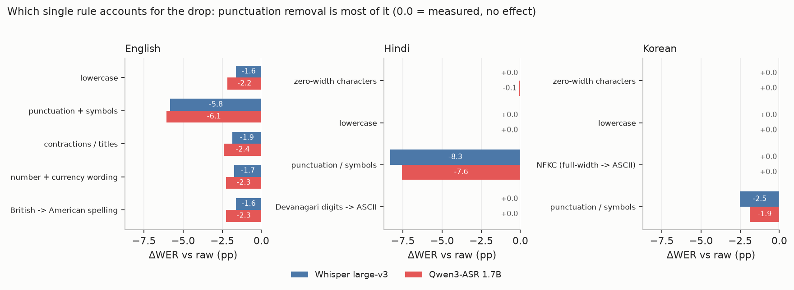

# What the results say

Everything below is computed from the committed artifacts:
`outputs/ablation.csv` (per-rule), `outputs/metrics_*.csv` (raw vs norm),
`outputs/per_sample_scores.csv` (per clip) and `docs/normalization_rules.md`
(bracket-policy experiment). Numbers are corpus WER % unless stated.

## 1. Which rule actually does the work

Each row applies **one** rule to the raw strings and re-scores; the drop is that rule alone.
Whisper / Qwen3-ASR deltas vs raw, in percentage points:

| rule | en | hi | ko |
|---|---:|---:|---:|
| punctuation + symbols | **−5.82 / −6.06** | **−8.29 / −7.57** | **−2.52 / −1.88** |
| lowercase | −1.63 / −2.17 | 0.00 / 0.00 | 0.00 / 0.00 |
| contractions / titles | −1.86 / −2.39 | — | — |
| number + currency wording | −1.73 / −2.27 | — | — |
| British → American spelling | −1.63 / −2.26 | — | — |
| zero-width characters | — | 0.00 / −0.08 | 0.00 / 0.00 |
| Devanagari digits → ASCII | — | 0.00 / 0.00 | — |
| NFKC / full-width → ASCII | — | — | 0.00 / 0.00 |
| **full pipeline** | **−7.32 / −7.21** | **−8.29 / −7.65** | **−2.52 / −1.88** |

Three things follow.

1. **Normalisation here is almost entirely punctuation removal.** In Hindi and Korean the full
   pipeline's effect equals the punctuation row to within 0.1 pp — the only addition anywhere is
   0.08 pp from zero-width stripping in Qwen3-ASR's Hindi output. In English punctuation is ~80% of
   the effect (−5.8 of −7.3), with another ~2 pp spread across case, contractions, numbers and
   spelling.
2. **Rule effects are not additive.** English marginals sum to −12.7 while the joint effect is
   −7.3, because the same error (e.g. `10:00` vs *10 to 11 p.m.*) is repaired by several rules at
   once. Any claim of the form "rule X is worth Y points" holds only when applied alone.
3. **Some rules are inert on this subset and should be labelled as such.** Devanagari digit folding,
   NFKC and lowercasing never fire on these 50 Hindi / 50 Korean clips (references already use ASCII
   digits; no full-width forms appear in either references or outputs). Zero-width stripping fires
   once, worth 0.08 pp. These rules stay in the pipeline as robustness for other data, but they are
   not part of the numbers in the README, and saying so is cheaper than implying otherwise.

## 2. What a "good" normalisation rule looks like

From the ablations and the bracket experiment, four properties separated useful rules from
harmful ones:

1. **Applied to both sides, identically.** Every rule here is applied to reference *and* output.
   A rule applied to one side is a scoring bug, not a normalisation choice.
2. **Removes presentation, never content.** Punctuation, case, width, zero-width glue: sign-stable,
   no risk of flipping the ranking. These are safe defaults.
3. **If it rewrites content, it is a policy decision whose sign can flip.** Bracket deletion helps
   Korean by 1.8–2.0 pp and hurts English/Hindi by 1.7–2.1 pp on the *same* predictions
   (`docs/normalization_rules.md`). Spelling and number folding behave the same way at smaller
   scale. No corpus-independent answer exists; the honest move is to measure and publish both.
4. **Fold symmetrically or not at all.** English maps spoken numbers to digits, Korean does not, so
   Whisper saying `백오십` where the reference has `150` is charged (error case 16). A rule that
   folds one direction systematically favours models that emit that form.

## 3. Regularities

**a. The size of the normalisation effect tracks style distance, not model quality.** Both models
lose nearly the same amount in each language (−7.32 vs −7.21 on English, −8.29 vs −7.65 on Hindi,
−2.52 vs −1.88 on Korean) even though their accuracy differs by 13 pp on Hindi. The penalty is a
property of the *pair* (reference style, model output style), so it should be reported once per
language and not as a per-model trait.

**b. One rule is universal, the rest are language-specific.** Punctuation removal works in all
three languages; everything beyond it was needed only for English, where the reference uses
Arabic-numeral dates, contractions and British spellings that the models render differently.

**c. Normalisation changes magnitude, not ranking.** The Qwen3-ASR − Whisper gap moves from
−7.05 pp (raw) to −6.57 pp (norm) — half a point — while individual scores move up to 8.3 pp.
That asymmetry is the practical argument for always publishing both variants: a bare number says
more about the ruler than about the system.

**d. The spacing-sensitive language shows the widest WER/CER split.** WER ÷ CER is 2.05 on English,
2.75 on Hindi and 3.46 on Korean: the more a language's orthography encodes word boundaries that
ASR can get wrong (Korean eojeol spacing), the more WER inflates relative to CER. The same effect
shows up in the error mix: Korean is ~40% deletions, Hindi ~3% (`fig_error_mix.png`).

**e. Error type follows the writing system.** Substitutions dominate everywhere (52–88% of edits).
Hindi's edits are almost entirely substitutions (88% for Whisper, 80% for Qwen3-ASR, 3% and 11%
deletions) — single words misspelled, not dropped. Korean's deletions are 40–42% of edits and come
from merging two eojeol into one, which the aligner books as one substitution plus one deletion. So "what kind of error" is largely a statement about orthography, not about the
acoustic model.

**f. Agreement is rare and disagreement is structural.** 37 of 150 clips are perfect for both
models; Qwen3-ASR is worse than Whisper on 10 clips (7 Korean, 2 English, 1 Hindi). Per-clip files make that
visible; the corpus averages hide it.

## 4. If you are evaluating an ASR system yourself

1. Publish **both** raw and normalised numbers; one number is unfalsifiable.
2. Start from punctuation + case for both sides; that is where nearly all the effect is.
3. Do not delete parenthetical text by reflex — measure it, and say which policy your table uses.
4. Fold numbers in both directions or not at all, and say which.
5. For languages where spacing is lexical (Korean, and partly Hindi compounds), report CER next to WER.
6. Ablate your pipeline before describing it; otherwise you attribute your score to rules that fire
   zero times.
7. Keep per-clip scores — 150 point estimates with a long tail cannot be summarised by one mean.

## 5. Limits of these conclusions

- Three languages, 50 clips each, read speech, one decoding configuration per model, no confidence
  intervals or significance tests. The English difference (≈1 pp) is not a ranking claim.
- Ablations are single-rule marginals; interactions between rules are real (see fact 2 above), so
  the table explains *where the effect comes from*, it does not partition it exactly.
- "Measured zero" means zero on these 50 clips, not that the rule can never fire.
- FLEURS reference style is one publisher's convention, and the references themselves contain typos
  and unspoken bracketed glosses (`error_analysis.md`, cases 12/14, 17). Treat the numbers as
  relative to this corpus, not as a general ASR quality scale.
